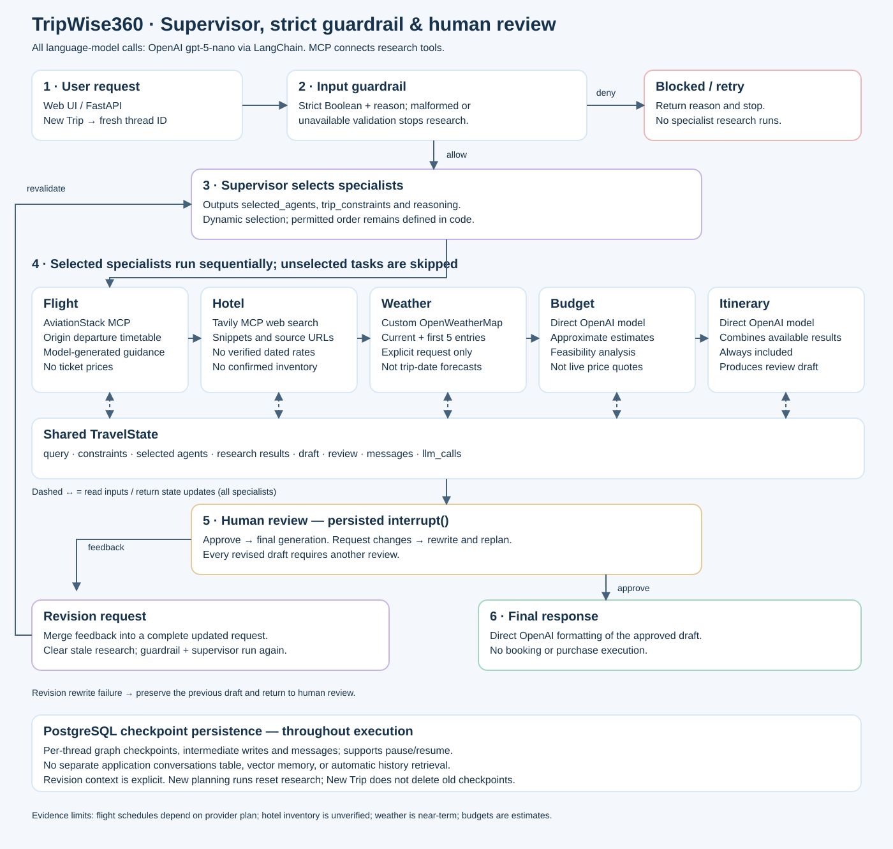
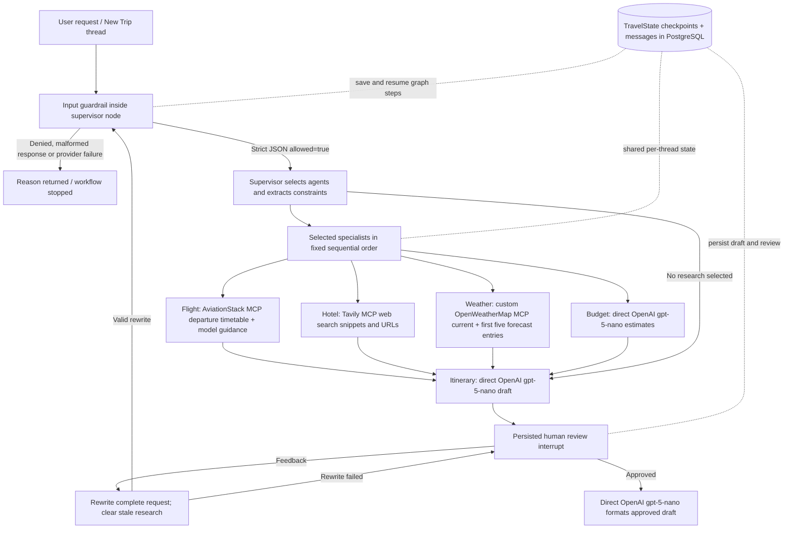

# TripWise360 — implemented architecture

Specialist arrows identify eligible tasks, **not parallel execution**. The implemented order is flights → hotels → weather → budget → itinerary, skipping unselected research tasks. Itinerary is always included. Weather is requested explicitly. The graph edges remain defined in code.

All model calls use **OpenAI `gpt-5-nano` through LangChain**, directly, including guardrail, supervisor, request rewriting, budget, itinerary and final generation. MCP connects external research tools, not the language model.

## Research evidence limits

- AviationStack: origin-airport departure timetable, provider-plan dependent. No ticket prices, confirmed booking availability, or destination/date-filtered route search.
- Tavily: search snippets and source URLs. No verified hotel inventory or structured rate comparison.
- Weather: current and near-term conditions for an extracted location. Five entries do not mean five daily forecasts; data is not aligned to travel dates.
- Budget: approximate model estimates, not independently priced quotes.

## Guardrail and review behavior

The guardrail requires an exact JSON object with `allowed` as a Boolean and `reason` as a string. Blocked results require a reason. Invalid/missing/extra fields or service failures stop research with a retry message. This does not guarantee comprehensive safety or validate all travel constraints.

Approval resumes the same thread and allows final generation. Feedback does not finalize: it updates the request, reruns validation and specialist selection, clears prior research, and produces a new draft that must be approved. The supervisor selects relevant agents afresh; selected tools run again rather than reusing potentially stale data. Revision rewrite errors preserve the previous draft for another review.

## Persistence and memory

`PostgresSaver` stores graph checkpoints, intermediate writes and state (including messages) keyed by thread. There is no separate application conversations table, vector memory, or automatic history retrieval in prompts. Each new planning run resets research and constraints. The revision loop explicitly carries the latest request forward. New Trip changes the thread ID; it does not delete historical database checkpoints.

State fields include `user_query`, `trip_constraints`, `selected_agents`, `flight_results`, `hotel_results`, `weather_results`, `budget_results`, `itinerary`, `approved`, `human_feedback`, `revision_count`, `messages` and `llm_calls`.
