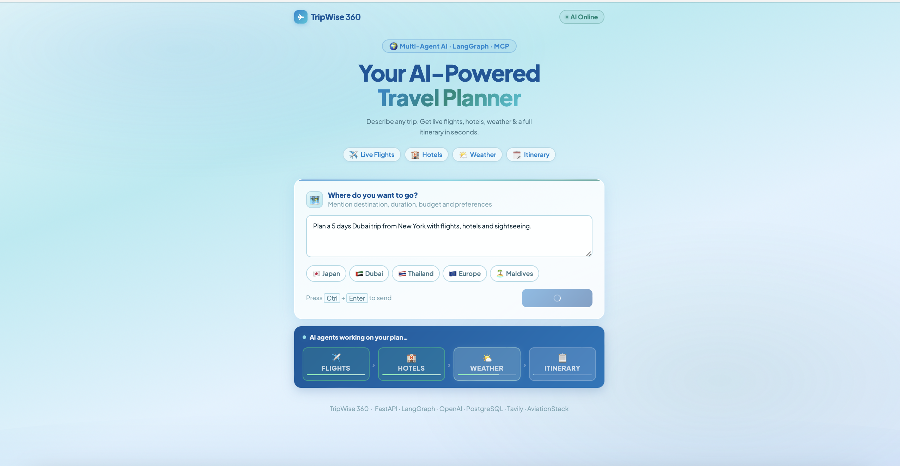
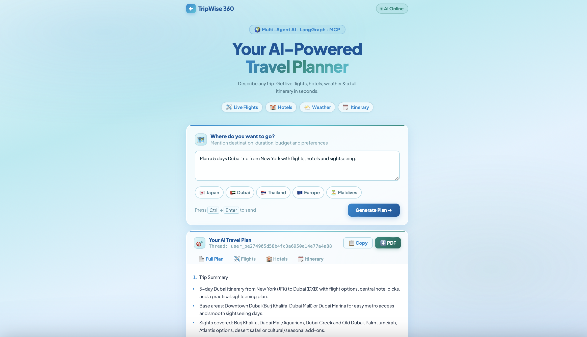
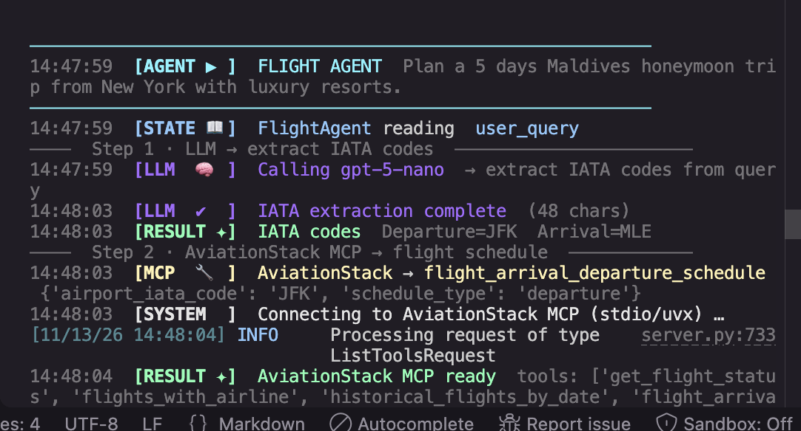

# ✈️ TripWise 360 — Multi-Agent AI Travel Planner

A production-ready, multi-agent AI travel planning application built with **LangGraph**, **LangChain**, **FastAPI**, and the **Model Context Protocol (MCP)**. Enter any natural-language travel request and get real-time flights, hotel recommendations, weather forecasts, and a full day-by-day itinerary — all generated autonomously by a team of specialized AI agents.



---

## 🌐 Live Demo

> Run locally — see [Getting Started](#-getting-started) below.

---

## 📸 Architecture

```
                        ┌──────────────────┐
                        │   User Request    │
                        │  (Natural Lang.)  │
                        └────────┬─────────┘
                                 │
                    ┌────────────▼────────────┐
                    │     FastAPI Endpoint     │
                    │      POST /api/travel    │
                    └────────────┬────────────┘
                                 │
                    ┌────────────▼────────────┐
                    │   LangGraph StateGraph   │
                    │   (Shared TravelState)   │
                    └────┬──────┬──────┬──────┘
                         │      │      │
           ┌─────────────▼─┐  ┌─▼────────────┐
           │ Flight Agent  │  │  Hotel Agent  │
           │               │  │               │
           │ AviationStack │  │  Tavily MCP   │
           │    MCP (stdio)│  │   (HTTP)      │
           └───────┬───────┘  └──────┬────────┘
                   │                 │
           ┌───────▼───────┐  ┌──────▼────────┐
           │ Weather Agent │  │Itinerary Agent│
           │               │  │               │
           │ Custom Weather│  │  OpenAI LLM   │
           │  MCP (stdio)  │  │               │
           └───────┬───────┘  └──────┬────────┘
                   │                 │
                   └────────┬────────┘
                            │
               ┌────────────▼────────────┐
               │      Final Agent         │
               │  Formats full response   │
               │      OpenAI LLM          │
               └────────────┬────────────┘
                            │
               ┌────────────▼────────────┐
               │   PostgreSQL (Render)    │
               │  LangGraph Checkpointer  │
               │  (Conversation Memory)   │
               └─────────────────────────┘
```

---

## 🧠 Key Concepts

### 1. LangGraph — Agent Orchestration
LangGraph is used to build a **directed state graph** where each node is a specialized AI agent. Agents run sequentially, each reading from and writing to a shared `TravelState` TypedDict. The graph handles execution order, state passing, and persistence automatically.

```python
graph.add_edge(START,            "flight_agent")
graph.add_edge("flight_agent",   "hotel_agent")
graph.add_edge("hotel_agent",    "weather_agent")
graph.add_edge("weather_agent",  "itinerary_agent")
graph.add_edge("itinerary_agent","final_agent")
graph.add_edge("final_agent",     END)
```

### 2. Model Context Protocol (MCP)
MCP is an open standard that allows LLM applications to connect to external tools and data sources via a unified interface. This project uses three MCP servers:

| MCP Server | Transport | Provider | Purpose |
|---|---|---|---|
| `aviationstack-mcp` | stdio (local) | AviationStack API | Real-time flight schedules |
| Tavily MCP | HTTP (remote) | Tavily Search API | Hotel & travel search |
| Custom Weather MCP | stdio (local) | OpenWeatherMap API | Current weather & forecasts |

### 3. Shared Agent State
All agents share a single typed state object. Each agent reads what it needs and writes its result back — no agent needs to know what others are doing.

```python
class TravelState(TypedDict):
    messages:       Annotated[list[AnyMessage], operator.add]
    user_query:     str
    flight_results: str
    hotel_results:  str
    weather_results:str
    itinerary:      str
    llm_calls:      int
```

### 4. PostgreSQL Checkpointer
LangGraph's `PostgresSaver` persists the full conversation state after every agent step. This enables **multi-turn conversations** — a user can follow up on a previous plan and the agent remembers the full context via `thread_id`.

### 5. Async Bridge (`run_async`)
LangGraph runs sync node functions in a thread pool executor inside FastAPI's async event loop. A custom `run_async()` helper detects whether a running event loop exists and routes async MCP calls through a dedicated daemon thread to avoid nested-loop errors.

---

## 🤖 Agent Pipeline

### Flight Agent
- Extracts departure and arrival IATA codes from the user query using an LLM call
- Calls `flight_arrival_departure_schedule` on AviationStack MCP with the IATA codes
- Generates flight guidance using live schedule data + LLM

### Hotel Agent
- Runs a Tavily web search for hotel options at the destination
- Returns structured results (name, price, reviews, links)

### Weather Agent
- Extracts the destination city using an LLM call
- Calls `get_current_weather` and `get_forecast` on the custom OpenWeatherMap MCP server
- Returns current conditions and a 5-step forecast

### Itinerary Agent
- Receives flight, hotel, and weather results from shared state
- Uses OpenAI LLM to generate a practical day-by-day plan

### Final Agent
- Combines all results into a single, beautifully formatted travel response
- Structures output into: Trip Summary, Flights, Hotels, Weather, Day-by-Day Itinerary, Budget, Recommendations

---

## 📁 Project Structure

```
TripWise360/
├── app.py                      # FastAPI app — routes & server
├── backend.py                  # LangGraph graph, all agents, run_async helper
├── mcp_client.py               # MCP client setup (Tavily, AviationStack, Weather)
├── custom_weather_mcp_server.py# Custom MCP server wrapping OpenWeatherMap API
├── requirements.txt
├── Dockerfile
├── .env                        # API keys (not committed)
├── tools/
│   └── flight_tool.py          # Legacy direct-API flight tool (reference only)
├── templates/
│   └── index.html              # Frontend UI
└── static/
    ├── style.css               # Ocean-blue light theme
    └── script.js               # Tab UI, agent animations, PDF export
```

---

## 🔧 Tech Stack

| Layer | Technology |
|---|---|
| **API Server** | FastAPI + Uvicorn |
| **Agent Framework** | LangGraph 1.x |
| **LLM** | OpenAI GPT (via LangChain) |
| **Tool Protocol** | Model Context Protocol (MCP) |
| **MCP Client** | `langchain-mcp-adapters` |
| **Flight Data** | AviationStack API (`aviationstack-mcp`) |
| **Web Search** | Tavily Search API (remote MCP) |
| **Weather Data** | OpenWeatherMap API (custom MCP server) |
| **Memory / State** | PostgreSQL via `langgraph-checkpoint-postgres` (AWS RDS) |
| **Frontend** | Vanilla HTML/CSS/JS + Marked.js + html2pdf.js |
| **Deployment** | Docker |

---

## 🚀 Getting Started

### Prerequisites

- Python 3.11+
- PostgreSQL database (local or [Render](https://render.com) free tier)
- API keys for: OpenAI, AviationStack, Tavily, OpenWeatherMap
- [`uvx`](https://docs.astral.sh/uv/getting-started/installation/) installed (runs MCP servers without manual install)

### 1. Clone the repo

```bash
git clone https://github.com/your-username/TripWise360.git
cd TripWise360
```

### 2. Create and activate a virtual environment

```bash
python -m venv .venv
source .venv/bin/activate        # macOS / Linux
.venv\Scripts\activate           # Windows
```

### 3. Install dependencies

```bash
pip install -r requirements.txt
```

### 4. Configure environment variables

Copy the example file and fill in your keys:

```bash
cp .env.example .env
```

> ⚠️ `.env` is listed in `.gitignore` and is **never committed**. Use `.env.example` as the reference template.

```env
# OpenAI
OPEN_API_KEY=<OpenAI API key>

# AviationStack — https://aviationstack.com (free tier works)
AVIATIONSTACK_API_KEY=<AviationStack API key>

# Tavily — https://tavily.com (free tier works)
TAVILY_API_KEY=<Tavily API key>

# OpenWeatherMap — https://openweathermap.org/api (free tier works)
OPENWEATHER_API_KEY=<OpenWeatherMap API key>

# Default origin airport IATA code
DEFAULT_ORIGIN_IATA=USA

# AWS RDS PostgreSQL (or any PostgreSQL connection string)
DATABASE_URL=postgresql://<user>:<password>@<host>/<db>

# LangSmith tracing (optional but recommended)
LANGSMITH_TRACING=true
LANGSMITH_ENDPOINT=https://api.smith.langchain.com
LANGSMITH_API_KEY=<LangSmith API key>
LANGSMITH_PROJECT=TripWise360
```

### 5. Run the app

```bash
python app.py
```

Open [http://127.0.0.1:8000](http://127.0.0.1:8000) in your browser.

### 6. (Optional) Verify MCP tools are loading

```bash
python test.py
```

This lists all tools available from each connected MCP server.

---

## 🐳 Docker

```bash
docker build -t tripwise360 .
docker run -p 8000:8000 --env-file .env tripwise360
```

---

## 🔑 API Keys & Plans

| Service | Free Tier Limit | Used For |
|---|---|---|
| OpenAI | Pay-per-use | LLM calls across all agents |
| AviationStack | 100 req/month | Flight schedules (`flight_arrival_departure_schedule`) |
| Tavily | 1,000 req/month | Hotel & travel web search |
| OpenWeatherMap | 60 calls/min | Current weather + 5-day forecast |
| AWS RDS PostgreSQL | db.t3.micro free tier | Conversation memory / checkpointing |

> **Note:** `list_airports` and `list_airlines` on AviationStack require the Basic plan. This project uses `flight_arrival_departure_schedule` which is available on the free tier.

---

## 💡 Key Design Decisions

**Why LangGraph instead of a simple chain?**
LangGraph gives each agent its own node with explicit edges, making it easy to add, remove, or reorder agents without touching other agents' logic. The shared state means any agent can access any prior result.

**Why MCP instead of direct API calls?**
MCP decouples the tool implementation from the agent logic. Swapping AviationStack for another flight API only requires changing the MCP server — the agents don't change. It also makes tools reusable across different LLM applications.

**Why a custom weather MCP server?**
OpenWeatherMap doesn't have a published MCP server. `custom_weather_mcp_server.py` wraps it in ~60 lines using `FastMCP`, making it a first-class tool indistinguishable from third-party MCP servers.

**Why PostgreSQL for state?**
LangGraph's `PostgresSaver` checkpointer persists the full graph state after every node execution. This enables true multi-turn conversations where users can refine their plan across multiple requests using the same `thread_id`. This project uses an **AWS RDS PostgreSQL micro instance** as the backing store.

---

## 📡 API Reference

### `POST /api/travel`

**Request:**
```json
{
  "message": "Plan a 7-day Japan trip from New York under $5000",
  "thread_id": "optional-existing-thread-id"
}
```

**Response:**
```json
{
  "success": true,
  "thread_id": "user_abc123",
  "answer": "## Your Complete Japan Trip Plan...",
  "flight_results": "## Flight Information...",
  "hotel_results": "## Hotel Recommendations...",
  "itinerary": "## Day-by-Day Plan...",
  "llm_calls": 4
}
```

### `GET /health`
```json
{ "status": "ok", "message": "AI Travel Planner API is running" }
```

---

## 🗺️ Flow Diagram

```
User Input
    │
    ▼
FastAPI (app.py)
    │  POST /api/travel
    ▼
run_travel_agent() ──────────────────────────────────────────────────────────┐
    │                                                                         │
    ▼                                                                         │
LangGraph StateGraph                                                          │
    │                                                                         │
    ├──► Flight Agent                                                         │
    │        │ LLM extracts IATA codes from query                            │
    │        │ AviationStack MCP → flight_arrival_departure_schedule          │
    │        │ LLM generates flight guidance                                  │
    │        └──► writes flight_results to state                             │
    │                                                                         │
    ├──► Hotel Agent                                                          │
    │        │ Tavily MCP → web search for hotels                            │
    │        └──► writes hotel_results to state                              │
    │                                                                         │
    ├──► Weather Agent                                                        │
    │        │ LLM extracts destination city                                 │
    │        │ Custom Weather MCP → current + forecast                       │
    │        └──► writes weather_results to state                            │
    │                                                                         │
    ├──► Itinerary Agent                                                      │
    │        │ Reads flight + hotel + weather from state                     │
    │        │ LLM generates day-by-day itinerary                            │
    │        └──► writes itinerary to state                                  │
    │                                                                         │
    └──► Final Agent                                                          │
             │ Reads all state fields                                         │
             │ LLM formats complete travel response                           │
             └──► returns final answer ◄────────────────────────────────────┘
                            │
                            ▼
                   PostgreSQL Checkpoint
                   (state saved per thread_id)
                            │
                            ▼
                   JSON Response → Frontend
```

---

## 🖥️ Demo Logs — Colored Terminal Output

TripWise 360 prints richly colored, structured logs to the terminal so you can follow every agent step, LLM call, MCP tool invocation, and state transition in real time — ideal for demos and debugging.

### UI — Main Interface


### UI — Agent Progress Tracker

The agent progress bar appears while the pipeline is running, showing each agent lighting up in sequence.



### Terminal — Colored Log Output



### Log Color Scheme

| Color | Tag | Fired when |
|---|---|---|
| **Bold White** | `[SYSTEM  ]` | App startup, graph build, DB connection |
| **Bold Cyan** | `[AGENT ▶ ]` / `[AGENT ✔ ]` | Agent node starts / finishes |
| **Bold Magenta** | `[LLM  🧠 ]` / `[LLM  ✔  ]` | Every LLM invocation and response |
| **Bold Yellow** | `[MCP  🔧 ]` / `[MCP  ✔  ]` | MCP tool call dispatched / result received |
| **Bold Red** | `[MCP  ✖  ]` / `[ERROR  ✖]` | MCP failure or non-fatal fallback |
| **Bold Blue** | `[STATE 📖]` / `[STATE 📝]` | Shared state read / write |
| **Bold Green** | `[RESULT ✦]` | Meaningful data obtained (IATA codes, MCP ready, etc.) |
| **Dim white** | `────` | Section dividers between pipeline steps |

### Sample Log Trace

```
════════════════════════════════════════════════════════════════
  🌍 TRIPWISE 360  ·  NEW REQUEST
  Thread : user_a2da006a1b104d4f889c8edb63bd44e0
  Query  : Plan a 5 days Maldives honeymoon trip from New York…
════════════════════════════════════════════════════════════════

────────────────────────────────────────────────────────────────
14:47:59  [AGENT ▶ ]  FLIGHT AGENT   Plan a 5 days Maldives honeymoon tri…
────────────────────────────────────────────────────────────────
14:47:59  [STATE 📖]  FlightAgent  reading  user_query
──── Step 1 · LLM → extract IATA codes ─────────────────────────────────────
14:47:59  [LLM  🧠 ]  Calling gpt-5-nano  → extract IATA codes from query
14:48:03  [LLM  ✔  ]  IATA extraction complete  (48 chars)
14:48:03  [RESULT ✦]  IATA codes   Departure=JFK  Arrival=MLE
──── Step 2 · AviationStack MCP → flight schedule ───────────────────────────
14:48:03  [MCP  🔧 ]  AviationStack → flight_arrival_departure_schedule
            {'airport_iata_code': 'JFK', 'schedule_type': 'departure'}
14:48:03  [SYSTEM  ]  Connecting to AviationStack MCP (stdio/uvx) …
14:48:04  [RESULT ✦]  AviationStack MCP ready   tools: ['get_flight_status', …]
14:48:05  [MCP  ✔  ]  AviationStack ← flight_arrival_departure_schedule
──── Step 3 · LLM → generate flight guidance ────────────────────────────────
14:48:05  [LLM  🧠 ]  Calling gpt-5-nano  → generate flight recommendations
14:48:08  [LLM  ✔  ]  flight recommendations complete  (1243 chars)
14:48:08  [STATE 📝]  FlightAgent  writing  flight_results
14:48:08  [AGENT ✔ ]  FLIGHT AGENT done   1243 chars written to state

────────────────────────────────────────────────────────────────
14:48:08  [AGENT ▶ ]  HOTEL AGENT
────────────────────────────────────────────────────────────────
14:48:08  [STATE 📖]  HotelAgent  reading  user_query
14:48:08  [MCP  🔧 ]  Tavily → tavily_search  {'query': 'Best hotels for…'}
14:48:09  [MCP  ✔  ]  Tavily ← tavily_search  {"results": […]}
14:48:09  [STATE 📝]  HotelAgent  writing  hotel_results
14:48:09  [AGENT ✔ ]  HOTEL AGENT done

────────────────────────────────────────────────────────────────
14:48:09  [AGENT ▶ ]  WEATHER AGENT
────────────────────────────────────────────────────────────────
14:48:09  [LLM  🧠 ]  Calling gpt-5-nano  → extract destination city
14:48:10  [LLM  ✔  ]  destination extraction complete
14:48:10  [RESULT ✦]  Destination identified   Maldives
14:48:10  [MCP  🔧 ]  WeatherMCP → get_current_weather  {'city': 'Maldives'}
14:48:11  [MCP  ✔  ]  WeatherMCP ← get_current_weather
14:48:11  [MCP  🔧 ]  WeatherMCP → get_forecast  {'city': 'Maldives'}
14:48:12  [MCP  ✔  ]  WeatherMCP ← get_forecast
14:48:12  [STATE 📝]  WeatherAgent  writing  weather_results
14:48:12  [AGENT ✔ ]  WEATHER AGENT done

────────────────────────────────────────────────────────────────
14:48:12  [AGENT ▶ ]  ITINERARY AGENT
────────────────────────────────────────────────────────────────
14:48:12  [STATE 📖]  ItineraryAgent  reading  flight_results
14:48:12  [STATE 📖]  ItineraryAgent  reading  hotel_results
14:48:12  [STATE 📖]  ItineraryAgent  reading  weather_results
14:48:12  [LLM  🧠 ]  Calling gpt-5-nano  → generate day-by-day itinerary
14:48:16  [LLM  ✔  ]  itinerary generation complete  (2187 chars)
14:48:16  [STATE 📝]  ItineraryAgent  writing  itinerary
14:48:16  [AGENT ✔ ]  ITINERARY AGENT done   2187 chars

────────────────────────────────────────────────────────────────
14:48:16  [AGENT ▶ ]  FINAL AGENT
────────────────────────────────────────────────────────────────
14:48:16  [STATE 📖]  FinalAgent  reading  flight_results
14:48:16  [STATE 📖]  FinalAgent  reading  hotel_results
14:48:16  [STATE 📖]  FinalAgent  reading  weather_results
14:48:16  [STATE 📖]  FinalAgent  reading  itinerary
14:48:16  [LLM  🧠 ]  Calling gpt-5-nano  → format complete travel response
14:48:21  [LLM  ✔  ]  final response formatting complete  (3456 chars)
14:48:21  [RESULT ✦]  Final response ready   3456 chars total
14:48:21  [AGENT ✔ ]  FINAL AGENT done   all sections assembled ✈️ 🏨 🌤️ 🗓️

════════════════════════════════════════════════════════════════
  ✅ PLAN COMPLETE  ·  Thread: user_a2da006a…  ·  LLM calls: 5
════════════════════════════════════════════════════════════════
```

### What the logs reveal about the architecture

- **Agent coordination** — each `[AGENT ▶]` / `[AGENT ✔]` pair shows the hand-off sequence: Flight → Hotel → Weather → Itinerary → Final
- **LLM calls are explicit** — every `[LLM 🧠]` line shows *why* the LLM is being called (extraction, generation, formatting), not just that it was called
- **MCP tool calls are traced** — `[MCP 🔧]` shows the exact tool name and arguments sent; `[MCP ✔]` confirms the response came back
- **State flow is visible** — `[STATE 📖]` / `[STATE 📝]` shows which agent reads and writes which field, making the shared-state pattern concrete
- **Timing is implicit** — the `HH:MM:SS` prefix on every line lets you see where time is actually spent (MCP round-trips vs LLM latency)

---

## 🤝 Contributing

1. Fork the repo
2. Create a feature branch: `git checkout -b feature/my-feature`
3. Commit your changes: `git commit -m "Add my feature"`
4. Push: `git push -u origin feature/my-feature`
5. Open a Pull Request

---

## 📄 License

MIT License — free to use, modify, and distribute.

---

## 🙏 Acknowledgements

- [LangGraph](https://github.com/langchain-ai/langgraph) — agent orchestration framework
- [LangChain MCP Adapters](https://github.com/langchain-ai/langchain-mcp-adapters) — MCP ↔ LangChain bridge
- [AviationStack](https://aviationstack.com) — real-time flight data API
- [Tavily](https://tavily.com) — AI-optimized search API
- [OpenWeatherMap](https://openweathermap.org) — weather data API
- [FastMCP](https://github.com/jlowin/fastmcp) — MCP server framework
