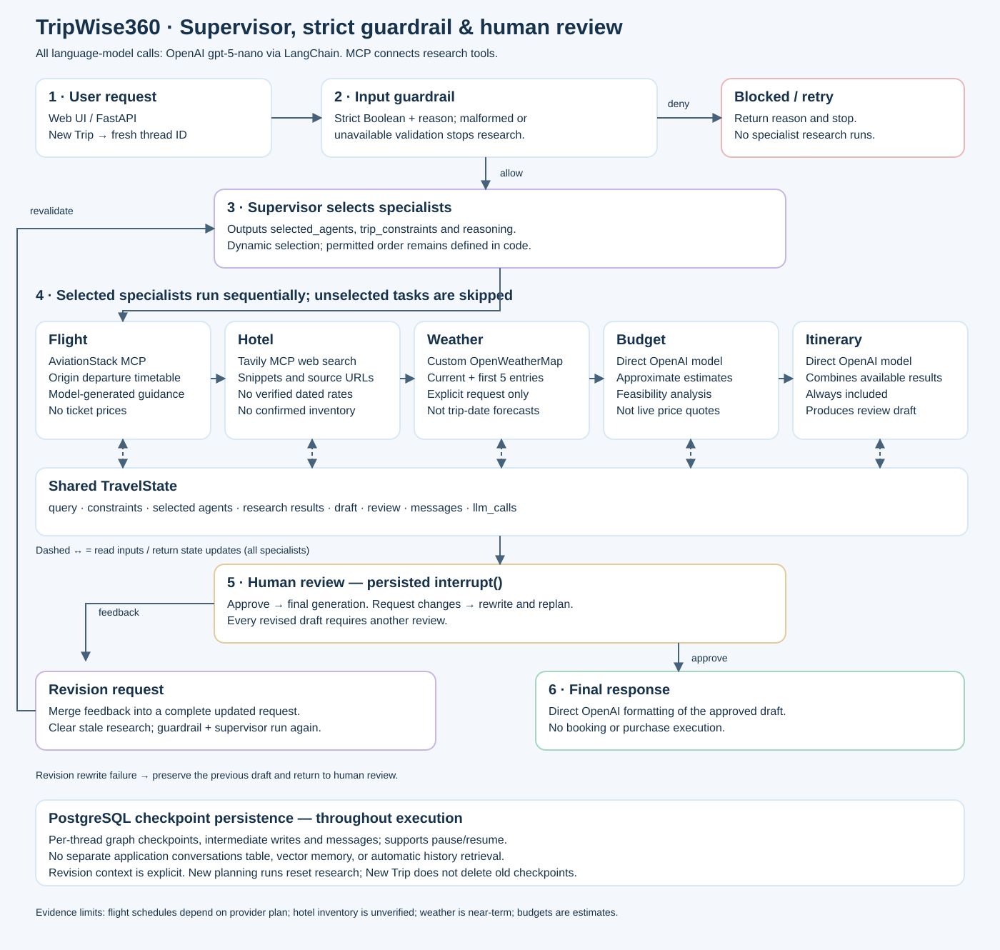

# ✈️ TripWise 360 — Multi-Agent Travel Planner

A learning and demo project showing **supervisor-based agent selection**, **input guardrails**, and **human-in-the-loop (HITL) review** with LangGraph, FastAPI, OpenAI, MCP tools, and PostgreSQL checkpoints.

Describe a trip, follow the selected specialists, review the draft, and either approve it or request another revision. You can reopen a saved trip by thread ID after restarting the app.

This application researches and drafts travel plans. It does not book flights or hotels, execute payments, or verify ticket and room availability.

## Screenshots

New screenshots will be added here. The obsolete screenshots have been removed; the slots below are ready for their replacements.

### Planning workspace

> **Screenshot placeholder:** Wide desktop layout showing the destination samples, **New Trip**, **Generate Plan**, and **Open a saved trip**.
>
> Suggested file: `docs/screenshots/planning-workspace.png`

<!-- Add when uploaded:  -->

### Selected agents and progress

> **Screenshot placeholder:** Supervisor-selected agents with queued, running, and completed states. Use a road-trip request to demonstrate that flights can be skipped.
>
> Suggested file: `docs/screenshots/agent-progress.png`

<!-- Add when uploaded:  -->

### Draft review and revisions

> **Screenshot placeholder:** Draft itinerary with **Approve & finalize**, feedback input, and **Request revised draft**. A second capture can show the revised draft awaiting approval.
>
> Suggested files: `docs/screenshots/draft-review.png`, `docs/screenshots/revised-draft.png`

<!-- Add when uploaded:  -->
<!-- Add when uploaded:  -->

### Saved-trip recovery

> **Screenshot placeholder:** **Open a saved trip** restoring a pending draft and its review controls from an existing thread ID.
>
> Suggested file: `docs/screenshots/saved-trip-recovery.png`

<!-- Add when uploaded:  -->

### Guardrail and final response

> **Screenshot placeholders:** A blocked unrelated request, followed by a separate example of an approved final plan.
>
> Suggested files: `docs/screenshots/guardrail-blocked.png`, `docs/screenshots/final-plan.png`

<!-- Add when uploaded:  -->
<!-- Add when uploaded:  -->

### Terminal logs

> **Screenshot placeholder:** Supervisor decisions, actual routing, specialist execution, HITL pause/resume, and final completion. Hide credentials and private trip details before sharing.
>
> Suggested file: `docs/screenshots/workflow-logs.png`

<!-- Add when uploaded:  -->

## Architecture



See [architecture details and editable Mermaid source](docs/architecture.md).

```text
User request
    ↓
Input guardrail → Blocked or invalid validation response → Reason returned; stop
    ↓ allowed
Supervisor selects specialists and extracts constraints
    ↓
Selected research agents → Itinerary draft
    ↓
Human review ── approve ──→ Final response
    │
    └── request changes → Rewrite complete request → Guardrail → Supervisor
                                                      ↓
                                    New research and draft → Human review again
```

PostgreSQL checkpoints persist state throughout the graph, including the human-review pause. Input validation and specialist selection are separate model calls inside the same supervisor node.

### Components

| Component | Current behavior |
|---|---|
| Input guardrail | Checks travel relevance and harmful intent. Strictly validates the model's JSON response and stops research on invalid output or provider failure. |
| Supervisor | Selects specialists, extracts `trip_constraints`, and records an explanation. |
| Flight agent | Extracts airport codes, attempts an origin-airport departure timetable through AviationStack MCP, then generates guidance. |
| Hotel agent | Retrieves Tavily MCP web-search results. |
| Weather agent | Extracts one destination and calls the custom MCP current-weather and forecast tools. The supervisor is instructed to select it only when weather is requested. |
| Budget agent | Generates approximate costs and feasibility analysis using the model. |
| Itinerary agent | Combines the available research into a draft. Always included. |
| Human approval node | Pauses with `interrupt()` and resumes with the user's decision. |
| Revision agent | Merges feedback into a complete updated request and clears stale research before revalidation and replanning. |
| Final agent | Formats the explicitly approved draft. Unapproved drafts cannot reach final generation. |

All model calls use **OpenAI `gpt-5-nano` directly through LangChain**. Budget and itinerary generation do not use Llama or an MCP-hosted model.

### Selection and execution order

The supervisor chooses which specialists participate. Selected agents execute **sequentially** in this permitted order:

```text
Flights → Hotels → Weather → Budget → Itinerary
```

Unselected research agents are skipped; itinerary generation always runs. The supervisor does not generate arbitrary graph edges or run specialists in parallel. If specialist-selection parsing fails, the current fallback selects flights, hotels, budget, and itinerary.

### MCP connections

| Server | Transport | Tool integration |
|---|---|---|
| AviationStack | Local stdio subprocess: `uvx aviationstack-mcp` | `flight_arrival_departure_schedule` |
| Tavily | Remote Streamable HTTP | `tavily_search` |
| Custom weather server | Local stdio subprocess using the app's Python environment | `get_current_weather`, `get_forecast` |

MCP connects external research tools. The shared model client is configured separately in `backend.py`.

## Run locally

### Prerequisites

- Python environment compatible with [requirements.txt](requirements.txt). The Docker image uses Python 3.12.
- A reachable PostgreSQL database and credentials that permit checkpoint-table setup.
- An OpenAI API key, plus credentials for the research services you intend to use: AviationStack, Tavily, and OpenWeatherMap.
- `uvx` available on `PATH` to launch the AviationStack MCP server.

The backend connects to PostgreSQL and sets up the checkpointer during import. OpenAI configuration and database connectivity must be available before the web server can start.

### 1. Clone and install

```bash
git clone https://github.com/clouddiary/TripWise360.git
cd TripWise360
python -m venv .venv
```

Activate the environment:

```bash
# macOS / Linux
source .venv/bin/activate
```

```powershell
# Windows PowerShell
.venv\Scripts\Activate.ps1
```

Install dependencies:

```bash
python -m pip install -r requirements.txt
```

### 2. Configure the environment

Copy [.env.example](.env.example) to `.env` and replace the placeholders:

```bash
cp .env.example .env
```

| Variable | Purpose |
|---|---|
| `OPEN_API_KEY` | OpenAI key. This is the exact variable name the current backend reads. |
| `DATABASE_URL` | PostgreSQL connection string for graph checkpoints. |
| `AVIATIONSTACK_API_KEY` | Flight MCP provider credential. The client forwards it as `AVIATION_STACK_API_KEY`. |
| `TAVILY_API_KEY` | Hotel web-search MCP credential. |
| `OPENWEATHER_API_KEY` | Custom weather MCP provider credential. |
| `LANGSMITH_TRACING`, `LANGSMITH_ENDPOINT`, `LANGSMITH_API_KEY`, `LANGSMITH_PROJECT` | Optional tracing settings included in the example file. |

`.env` is ignored by Git. Do not commit real credentials.

If `DATABASE_URL` has no `sslmode` parameter, the backend appends `sslmode=require`. For a local PostgreSQL instance without TLS, explicitly use `sslmode=disable` in that local connection string. Use the appropriate TLS settings for a hosted database.

Origin airport codes are extracted from the request; there is no configured default-origin fallback.

**Provider access:** Discovering an MCP tool does not establish subscription entitlement. The flight agent currently calls an airport timetable tool; do not assume a free AviationStack plan permits it. Tool failures can lead to general flight guidance. This README intentionally does not quote changing provider prices or quotas.

### 3. Start the app

```bash
python app.py
```

- UI: [http://127.0.0.1:8000](http://127.0.0.1:8000)
- Interactive API documentation: [http://127.0.0.1:8000/docs](http://127.0.0.1:8000/docs)
- Basic process health: [http://127.0.0.1:8000/health](http://127.0.0.1:8000/health)

`python app.py` starts Uvicorn with development reload enabled. The health endpoint is not a live readiness check of every provider.

## Try the demo

1. Enter a request or select **Dubai**, **Europe**, **Canada**, **Saudi**, or **Maldives**.
2. Click **Generate Plan**. The guardrail runs before specialist selection.
3. Watch the agent cards. Progress is read from graph checkpoints about every 1.5 seconds, rather than simulated with fixed agent timers. Very short steps may finish between polls. “Completed” means the node returned, not that every provider supplied usable data.
4. Review the draft. The final agent has not run yet.
5. Choose **Approve & finalize**, or enter feedback and choose **Request revised draft**.
6. A revision rewrites the current request, reruns the guardrail and supervisor, clears old research, and runs the newly selected specialists. Review the new draft again before approval.
7. Copy the displayed result or export a PDF. A draft export is still a draft, not an approval.

**New Trip** creates a fresh thread and clears the browser's current input, results, pending review, errors, and progress. Late responses from a previous trip are ignored. It does not delete previous PostgreSQL checkpoints.

### Suggested requests

| Demonstration | Request |
|---|---|
| Road-trip selection | “Plan a 4-day road trip from Toronto to Montreal. No flights. Include hotels and a budget estimate.” |
| Weather selection | “Plan a 5-day Dubai trip with hotels and a weather forecast.” |
| Budget analysis | “Plan a 7-day Canada trip from New York with a total budget of 3000 USD.” |
| Revision loop | On the draft: “Make it six days and include vegetarian restaurants.” |
| Guardrail | “Write a sorting algorithm.” |

Selections are model decisions guided by the supervisor prompt. Check the displayed selection and terminal logs when demonstrating them.

### Recover a trip tomorrow or after a restart

There is no approval timeout configured by this app. A pending review can be resumed while its database checkpoints remain available.

1. Save the displayed `thread_id`.
2. Restart the app using the **same PostgreSQL database**.
3. Paste only the ID into **Open a saved trip** and click **Open Trip**.
4. Pending drafts restore approval and revision controls. Completed trips show the final response.

Opening a saved trip reads checkpoints; it does not rerun agents. Browser `sessionStorage` restores a pending review on refresh, but may be lost when the tab or browser closes. The database remains the recovery source.

The main textarea is for new planning instructions. Typing “open thread …” there starts a planning request and may be blocked as unrelated; use **Open Trip** instead. A new planning run resets constraints and research, so do not use **Generate Plan** as a substitute for loading a saved draft.

## API reference

See `/docs` for request schemas. Examples below are illustrative; response text, selected agents, and call counts vary.

| Method | Endpoint | Purpose |
|---|---|---|
| `GET` | `/` | Planning UI |
| `POST` | `/api/travel` | Start a planning run; typically returns a draft awaiting review |
| `POST` | `/api/travel/approve` | Resume a pending review with approval or revision feedback |
| `GET` | `/api/travel/threads/{thread_id}` | Load a saved pending or completed trip without graph execution |
| `GET` | `/api/travel/progress/{thread_id}` | Read checkpoint-based agent statuses; optional `run_id` query parameter filters stale runs |
| `GET` | `/health` | Basic process status and feature names |

### Start planning

```json
{
  "message": "Plan a 5-day Dubai trip with hotels and a budget estimate."
}
```

Optional `thread_id` associates the new run with a thread; optional `run_id` identifies that run for progress polling. Omitting `thread_id` generates one. Use a fresh thread for an independent trip.

Responses include `success`, `thread_id`, `user_query`, `answer`, `requires_approval`, `approval_request`, `selected_agents`, `trip_constraints`, `supervisor_reasoning`, research-result fields, `itinerary`, guardrail fields, `approved`, `human_feedback`, `revision_count`, `revision_error`, and `llm_calls`.

- `requires_approval: true`: display the draft and review controls.
- A blocked request can return HTTP 200 with `success: true` and `guardrail_allowed: false`: processing succeeded, but research was not authorized.
- Research fields can contain raw MCP data or unavailable messages; they are not uniformly structured evidence objects.
- `llm_calls` is the current implementation's approximate counter, not exact billing or token usage.

### Approve a draft

```json
{
  "thread_id": "user_replace_with_saved_id",
  "approved": true,
  "feedback": ""
}
```

### Request a revised draft

```json
{
  "thread_id": "user_replace_with_saved_id",
  "approved": false,
  "feedback": "Change the destination to Canada and make it seven days."
}
```

Review input is strict: `approved` must be a JSON Boolean, not `"true"`, `"false"`, or a number. Revision feedback must be nonempty. Invalid request bodies return validation errors. Resume requires a currently interrupted thread. Successful revision returns another pending draft, not an automatically approved final plan. If request rewriting fails, the old draft is retained for another review.

### Load a saved trip

```text
GET /api/travel/threads/user_replace_with_saved_id
```

- `200`: saved pending review, final response, or blocked result.
- `404`: no checkpoint state found for the ID.
- `409`: the thread has pending execution without a review interrupt; it may still be running or have stopped before review.
- `500`: checkpoint retrieval could not be completed.

Use the same database that originally stored the trip.

## State, persistence, and memory

`TravelState` holds the current request, extracted constraints, selection, specialist outputs, draft, human feedback, revision metadata, final response, messages, and call counter.

`PostgresSaver` persists per-thread graph checkpoints and intermediate writes. It enables durable HITL pause/resume and cross-agent state sharing. There is no separate application conversations table, vector memory, or automatic retrieval of old conversation history into planning prompts. A revision explicitly carries the current request forward; a new planning run resets constraints and research.

The graph runs synchronously in FastAPI worker threads so the event loop can serve progress requests. `run_async()` bridges synchronous nodes to asynchronous MCP calls.

## Research and guardrail limits

| Area | What the current implementation establishes |
|---|---|
| Flights | Origin-airport departure timetable and model guidance. No destination/date-filtered booking search, live ticket quotes, or confirmed availability. |
| Hotels | Web-search snippets and URLs. No verified room inventory or structured dated rate comparison. |
| Weather | One extracted location, current conditions, and the first five provider forecast entries. Not five daily forecasts, multi-city aggregation, or weather aligned to future trip dates. |
| Budget | Approximate model estimates and feasibility advice, not independently priced quotes. |
| Input guardrail | LLM relevance/safety assessment with strict response validation. It does not comprehensively validate travel dates, duration, budget, or policy compliance. |
| Guardrail failures | Missing/extra fields, incorrect types, malformed JSON, and provider exceptions stop research. A denied decision requires a nonempty reason. |
| Human review | Controls whether a draft is finalized. Revisions can make additional model and provider calls; every revised draft requires approval. |

This is a local learning demo: thread IDs are not an authentication mechanism, and the current API has no user ownership checks. Shared/public deployment needs authentication and thread authorization.

## Project structure

```text
TripWise360/
├── app.py                         # FastAPI routes and worker-thread graph calls
├── backend.py                     # Supervisor, specialists, routing, review/revision, checkpoint helpers
├── workflow_rules.py              # Strict guardrail, review, and revised-request contracts
├── mcp_client.py                  # AviationStack, Tavily, and weather tool clients
├── custom_weather_mcp_server.py   # OpenWeatherMap tools exposed through FastMCP
├── logger.py                      # Colored console logging
├── test.py                        # Live MCP tool-discovery diagnostic
├── tests/
│   └── test_review_workflow.py     # Offline graph and contract regression tests
├── templates/index.html           # Planning, saved-trip loading, and review controls
├── static/
│   ├── script.js                  # API calls, progress polling, session reset, review UI
│   └── style.css                  # Responsive workspace styles
├── docs/
│   ├── architecture.md            # Architecture notes and Mermaid source
│   ├── architecture-shared-state.svg           # Current diagram
│   └── screenshots/               # Planned screenshot location; slots listed above
├── .env.example                   # Configuration template; actual .env stays local
├── requirements.txt
└── Dockerfile
```

## Testing and diagnostics

Run the offline regression suite:

```bash
python -m unittest discover -s tests -v
```

The suite uses real LangGraph execution and in-memory checkpoints with mocked model and specialist responses. It covers strict guardrail/review contracts, revisions and repeated review, stale-research clearing, revalidation, rewrite failure recovery, saved-thread loading, and approval after recreating the graph instance. It does not exercise live PostgreSQL, external provider availability, browser rendering, or model decision quality.

Basic syntax checks:

```bash
python -m py_compile app.py backend.py workflow_rules.py
node --check static/script.js
```

Node.js is needed only for that optional JavaScript check; the application backend is Python.

Live MCP discovery:

```bash
python test.py
```

This connects to configured MCP servers and lists tools. It requires the relevant credentials/network access and is separate from the offline tests. Tool discovery does not prove that the provider permits or returns useful data for a specific call.

## Logging

Terminal logs identify node starts/completions, guardrail outcomes, supervisor selections, routing, model calls, MCP calls, state inputs/outputs, and human-review pause/resume. Available-result reads are logged conditionally to avoid implying that skipped specialists ran.

| Tag | Meaning |
|---|---|
| `[SYSTEM]` | Startup, routing, checkpoint pause/resume, or graph status |
| `[AGENT ▶]` / `[AGENT ✔]` | Node started / returned |
| `[LLM]` | Model invocation and response |
| `[MCP]` | Tool invocation, result, or tool error |
| `[STATE]` | State input/output |
| `[RESULT]` | Decision or useful result summary |
| `[ERROR]` | Failure or fallback |

An interrupted graph is logged as paused rather than complete. The human-review node runs again on resume, so its entry log can appear again. A returned tool call or completed node is not proof that its payload contains valid research.

## Docker

```bash
docker build -t tripwise360 .
docker run --rm -p 8000:8000 --env-file .env tripwise360
```

The Dockerfile uses a Python 3.12 multi-stage build, installs the Python dependencies and `uvx`, and starts Uvicorn on port 8000 with two workers. Runtime credentials are supplied through environment variables; `.env` is not copied into the image. PostgreSQL must be reachable from the container. The image's live provider subprocesses and database connection still need validation in your target environment.
